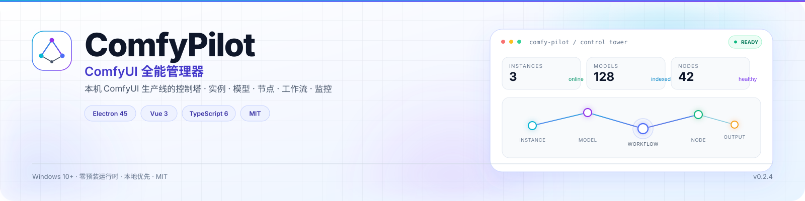
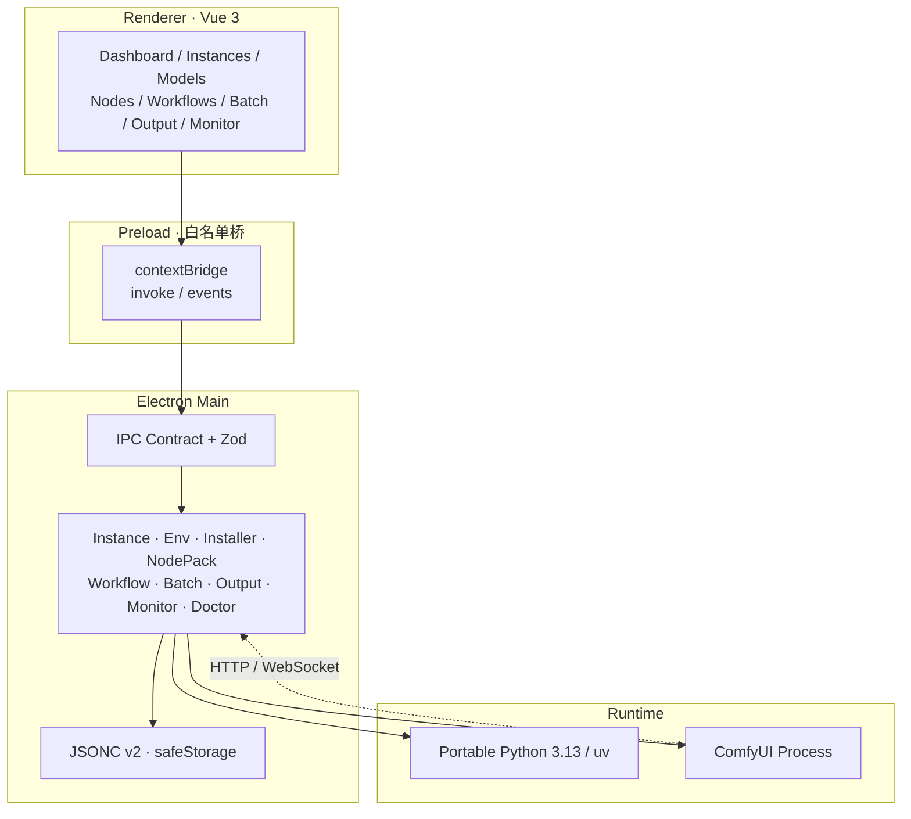

<a name="readme-top"></a>

<p align="center">
  <picture>
    <source media="(prefers-color-scheme: dark)" srcset="./docs/assets/banner-dark.svg">
    <source media="(prefers-color-scheme: light)" srcset="./docs/assets/banner-light.svg">
    
  </picture>
</p>

<h1 align="center">ComfyPilot</h1>

<p align="center">
  <b>ComfyUI 全能管理器</b> · 本机 ComfyUI 生产线的控制塔<br>
  <sub>实例 · 环境 · 模型 · 节点 · 工作流 · 批跑 · 产物 · 监控 · 诊断 · 备份</sub>
</p>

<p align="center">
  <a href="https://github.com/ThzxxArt/ComfyPilot/releases"></a>
  <a href="https://github.com/ThzxxArt/ComfyPilot/actions/workflows/ci.yml"></a>
  <a href="./LICENSE"></a>
  <a href="https://github.com/ThzxxArt/ComfyPilot/releases"></a>
  <a href="https://github.com/ThzxxArt/ComfyPilot/stargazers"></a>
</p>

<p align="center">
  
  
  
  
  
</p>

<p align="center">
  <a href="#why"><b>为什么</b></a> ·
  <a href="#quickstart"><b>一分钟上手</b></a> ·
  <a href="#features"><b>功能地图</b></a> ·
  <a href="#architecture"><b>架构</b></a> ·
  <a href="#quality"><b>质量</b></a> ·
  <a href="#install"><b>安装</b></a> ·
  <a href="#changelog"><b>版本</b></a> ·
  <a href="#faq"><b>FAQ</b></a>
</p>

---

ComfyPilot **不替代** ComfyUI 的节点画布。它把画布之外的一切——运行时、模型、节点包、工作流、队列、产物与故障——收进一个可观测、可修复、可回滚的桌面控制塔。

> [!TIP]
> **已有 ComfyUI？** 不需要重装。在「实例」页发现并接管现有目录，ComfyPilot 会读取它的 Python、模型、节点与版本，再决定是否修复或更新。

---

<a name="why"></a>

## ✨ 为什么是 ComfyPilot

| 原则 | 说明 |
| --- | --- |
| 🎛️ **控制塔，不是编辑器** | 节点画布交给官方 ComfyUI Frontend。ComfyPilot 负责它周围的实例、环境、资产与运行状态。 |
| 📦 **零预装** | 用户不需要提前安装 Python、Git 或 uv。便携运行时、ComfyUI、torch 与基础模型由一条装机流水线准备。 |
| 🔍 **只读事实** | 版本、环境、端口、队列与产物都从磁盘、进程、HTTP 与 WebSocket 读取，不靠猜测。 |
| 🛡️ **根因修复** | 删除保护、realpath 复核、原子恢复、全量门禁；每个正向测试都必须配一个失败/拒绝反例。 |

<a name="quickstart"></a>

## 🚀 一分钟上手

| 01 · 下载 | 02 · 一键装机 | 03 · 启动出图 |
| --- | --- | --- |
| 安装 Windows x64 安装包。无需预装 Python / Git / uv。 | 选择安装目录与 GPU 通道；自动下载便携运行时、拉取 ComfyUI、安装 torch 与依赖。 | 启动实例 → 打开 Frontend → 下载推荐模型 → 出图。 |
| [**下载最新版 →**](https://github.com/ThzxxArt/ComfyPilot/releases/latest) | 支持 zip 源码包（默认）或 git clone。 | 完成后可随时检查更新、修复环境或回滚。 |

<p align="center">
  <a href="https://github.com/ThzxxArt/ComfyPilot/releases/latest">
    
  </a>
  <a href="https://github.com/ThzxxArt/ComfyPilot/releases/tag/v0.2.4">
    
  </a>
</p>

> [!WARNING]
> **0.2.0 起只支持 Python 3.13.x。** IPC 通道、JSONC 数据格式（`schemaVersion: 2`）、备份格式与 Python 运行时均已升级且**不向下兼容**。首次启动会生成 `pre-upgrade-<ts>` 快照并做一次性 v1→v2 迁移；旧 3.12 实例会被阻断并进入迁移向导；cu124 通道已移除。

<a name="features"></a>

## 🧭 功能地图

| 图标 | 模块 | 你能做什么 |
| --- | --- | --- |
| 🛰️ | **实例控制** | 发现 / 启动 / 停止 / 重启 / 强杀；就绪探测、端口冲突自愈；9 组启动参数、冲突校验、实时预览、按显存推荐；在线能力探测、启动脚本导出、诊断包；ComfyUI 本体检查更新、备份回滚；启动自检与一键修复环境。 |
| 🧰 | **一键装机** | 自动准备 uv / 便携 Python 3.13 / MinGit；zip 或 git 获取 ComfyUI；按 GPU 推荐 torch 通道；PyPI / Torch / GitHub 镜像测速；断点续传 + SHA256；推荐基础模型。 |
| 🧠 | **模型库** | 多根扫描、safetensors 元数据、SHA256 去重；断点下载与校验；移动 / 软链 / 改名；存储分析；与运行中实例在线对账；多选批量删除 / 移动。 |
| 🧩 | **节点包** | Registry / Manager / Git 安装；依赖真实安装；启用 / 禁用 / 锁定；冲突检测；导入冒烟；安装/更新前快照；全量检查更新与一键批量更新；启动加载报告；依赖体检与配方修复。 |
| 🛒 | **市场** | Comfy Registry 精选浏览与一键安装。 |
| 🎞️ | **工作流** | JSON / PNG 元数据解析并入库；标签 / 收藏 / 改名 / 删除；ZIP 导出；同步到实例；导入引擎默认工作流；按实例排队。 |
| 🚀 | **批跑** | 多工作流 × 次数；种子策略 + 尺寸 / steps / cfg 矩阵；真实出图跟踪；取消可撤队；产物关联批次。 |
| 🖼️ | **产物** | 图像 / 视频 / 音频 / 3D / EXR 全类型索引；真缩略图；灯箱与内嵌播放；排序分页；收藏；批量导出 / 删除；PNG 参数还原为工作流；实例资产库只读增强。 |
| 📈 | **监控** | CPU / 内存 / 磁盘 / GPU 真实采样；ComfyUI 队列与历史；WebSocket 实时进度；节点级进度；作业列表；清队列 / 中断 / 释放显存；远程实例监控。 |
| 🩺 | **诊断 / 备份** | Doctor 一键体检与可修复项；结构化运行失败诊断；启动自检；崩溃归因；配置 / 实例 / 节点 / 模型快照与原子恢复。 |
| 🌐 | **网络** | HTTP / HTTPS / SOCKS5 代理；PyPI / Torch / GitHub / HuggingFace 镜像；测速自动推荐。 |

<details>
<summary><b>完整功能详解</b></summary>

### 实例

- **发现**：扫描 Desktop / Portable / 源码目录、自定义根与 `extra_model_paths.yaml` 相关路径。
- **生命周期**：启动并打开 / 停止 / 重启 / 强杀（二次确认）；全部启动 / 全部停止。
- **启动参数模板**：默认本地、高质量预览（taesd）、启用 Manager、完全离线、局域网共享、低显存、省显存·新版、省内存、CPU 模式。
- **启动参数调优**：显存 / 预览 / 缓存 / 注意力 / 精度 / IO / 基础目录 / 网络 / 杂项 9 组结构化选项；互斥组单选、冲突即时校验、实时预览；存储目录组可重定向 output / input / temp / previews；未知或仅新版参数只警告不阻断。
- **extra_model_paths**：检测到实例根下 `extra_model_paths.yaml` 时启动自动显式加载，自定义 cwd 也不会丢模型路径。
- **默认不抢浏览器**：未显式声明时自动追加 `--disable-auto-launch`；显式 `--auto-launch` 时跳过。
- **端口**：占用检测、空闲建议、冲突时确认换端口并持久化；已运行的外部 ComfyUI 可采用，不误杀。
- **就绪探测**：轮询 `/system_stats`，就绪后才打开 Frontend。
- **启动脚本**：预览命令、一键导出 `.bat` / `.sh`（平台安全转义）。
- **环境探测与诊断包**：解释器、Python / Torch / CUDA、venv 完整性；配置与日志摘要导出。
- **在线能力**：`/system_stats` + `/features` + 资产系统状态；前端包版本一键对齐；ComfyUI 本体检查更新、备份回滚；启动自检与一键修复环境。

### 模型库

- 分类：checkpoint / diffusion_models / unet / loras / vae / clip / text_encoders / controlnet / upscale_models / embeddings / other。
- safetensors header 元数据（不加载权重）；SHA256 批量哈希与重复组。
- 下载：http(s) 直链、Civitai / HuggingFace 智能展开；断点续传；完成长度 / SHA256 校验；失败自动重试 3 次；全局并发上限 3。
- 推荐模型包：SD1.5 / SDXL / Flux 一键下载到当前实例 `models/`。
- 批量改名、存储分析、真缩略图（`comfy-pilot-media:` 受控协议）；与运行中实例在线对账；多选批量删除 / 移动。

### 节点包

- 来源：Comfy Registry API、Manager channel、Git URL、本地扫描（支持指定 branch）。
- Git 安装校验：仅 https / ssh / git@，拦截 `ext::`、注入型主机/分支；自动使用便携 MinGit。
- 依赖安装：`pip install -r requirements.txt` 真实等待完成，失败写入 issue。
- 健康：requirements 提示、节点名冲突、`__init__.py` 真实导入冒烟。
- 更新：检查更新全量覆盖每个已安装包并给出显式状态（可更新 / 已最新 / 无法检查 / 检查失败 / 已禁用 / 已锁定）；Registry 匹配支持 registryId → 仓库 URL → 唯一名字三级。
- 一键/批量更新：批量按顺序逐个更新，弹框实时显示总进度、第 N/M 个包与终端日志；弹框不会自动关闭，可「停止剩余」或手动关闭。
- 快照：安装 / 更新 / 卸载前自动快照；恢复为启用状态对齐（不回滚版本，UI 已明示）。
- 依赖体检：requirements.txt vs 已装包对账 + 单包补装；`triton` / `onnx` / SageAttention 走 curated recipe。

### 工作流与批跑

- **工作流库**：默认 `userData/data/workflows`（设置可改）；导入 = 拷贝入库，可感知落点。
- `.json` 工作流与 PNG 内嵌 workflow / prompt；PNG 导入同时抽出可排队的 `.json`。
- UI 格式 → API prompt 转换（KSampler 动态 widget、ControlNetLoader 等）。
- 标签 / 收藏 / 重命名 / 删除（库文件真删，实例侧只取消登记）/ ZIP 打包分享。
- 同步到实例 `user/default/workflows` 并打开 Frontend；按实例提交队列，可注入 seed。
- **批量任务**：从库多选工作流、次数、种子策略、尺寸 / steps / cfg 矩阵；入队后等待真实出图；取消立即生效并尝试撤队。

### 产物

- output 目录索引、类型筛选（图像 / 视频 / 音频 / 3D）、真缩略图（自动愈合死链）、排序 + 分页。
- 全类型覆盖：3D 模型（.glb / .gltf / .obj / .fbx / .ply / .stl）、音频（.wav / .mp3 / .flac / .ogg / .m4a…）、EXR / HDR / TIFF 原始图；浏览器不可解码的格式诚实降级系统程序打开。
- 视频：网格首帧 + 播放角标；灯箱内嵌播放（mp4 / webm 原生，mkv / mov 优雅降级）。
- PNG 参数面板（seed / 元数据）+ 还原为工作流（真入库）。
- 收藏、多选导出 ZIP、按批次 / 工作流过滤、回溯跳转；实例资产库只读增强（0.40 assets：promptId 溯源 / 标签 / EXR 预览）。
- 扫描深度可调（设置 → 路径 → 产物扫描深度，默认 4）。

### 监控与诊断

- 系统：CPU / 内存 / 磁盘；GPU 真实显存（systeminformation + Windows 性能计数器回退）。
- ComfyUI 队列与历史；WebSocket 进度（断线无限重连）；节点级进度；作业列表；清队列 / 中断 / 释放显存；远程实例统一入口。
- Doctor：Python / pip / torch·CUDA / 端口 / 节点 / 路径 / 磁盘 / 网络一键体检 + 可修复项（ensurepip、迁移 Python、创建目录、解除 torch 固定版本等）。
- 运行失败结构化诊断：WS `execution_error` 全载荷 + 日志 traceback 双通道；节点→包归属；一键安装缺失包 / 配方修复 / 复制报告 / 跳转节点包。

</details>

<a name="design"></a>

## 🖥️ 界面与体验

- **亮色现代风**：浅色背景、渐变强调色、微光玻璃卡片、大圆角；应用本体刻意不做深色主题，README 横幅会跟随 GitHub 主题切换。
- **Naive UI + 设计 token 对齐**：颜色、圆角、阴影与间距统一从 `themeOverrides` 与设计 token 出发。
- **完整中英双语**：装机向导、启动器、诊断、节点、工作流与错误提示均纳入 i18n；CI 强制键对齐。
- **小屏与可访问性**：名称单行省略 + 悬停全文、描述两行截断、卡片等高；首屏骨架屏；`prefers-reduced-motion`；键盘焦点环与快捷键。

| 主色 | 强调 | 辅助 |
| --- | --- | --- |
| 🟦 `#4F6EF7` | 🟪 `#7C5CFC` | 🩵 `#22D3EE` |

<a name="architecture"></a>

## 🏗️ 架构一览



- **渲染层没有 Node 权限**：所有能力经 preload 白名单暴露；IPC 参数由 Zod 契约校验。
- **主进程拥有进程、文件与网络**：实例生命周期、安装器、节点包、工作流、批跑、产物与诊断都在这里收敛。
- **运行时隔离**：便携 Python / uv / MinGit 在 `userData/runtimes`；实例使用独立 venv。
- **与 ComfyUI 松耦合**：通过进程管理、HTTP 与 WebSocket 交互，不静态链接 ComfyUI 源码。

<a name="quality"></a>

## 🧪 质量工程

| 维度 | 现状 |
| --- | --- |
| **测试** | **1930 用例 / 148 文件**；含 `@vue/test-utils` 全页面挂载、preload 桥、Electron 主入口、IPC 域、任务中心与全组件冒烟。 |
| **覆盖率** | statements **64.64%** · branches **53.84%** · functions **49.48%** · lines **66.80%** |
| **覆盖分母** | **172 个运行时代码文件**：`src/main`、`src/preload`、`src/shared`、`src/renderer/src`；仅排除 `.d.ts` 与真实 Electron E2E 覆盖的 `bootstrap.cjs`。 |
| **CI** | Ubuntu + Windows 双平台；Node 24.19.0 固定；typecheck / lint / format / i18n / 硬编码 / 行为占比 / 正反例 / coverage / build / asar / E2E。 |
| **E2E** | 真实 Electron 启动、preload 桥、一次真实 IPC、渲染层 console 错误置红。 |
| **反例门禁** | 任何含正向断言的测试文件必须至少有一个失败/拒绝用例；禁止 happy-path-only。 |

> [!NOTE]
> **“绝对全面”指分母覆盖全部运行时代码，不是 100% 行覆盖。** 旧版 83% 是手选子集的数字；把 16 个页面视图与 Electron 入口纳入后，真实数字就是上面这组。门禁按实测 −2pp 设置全局下限，并对每个文件执行 `coverage-baseline.json` ratchet。

<a name="install"></a>

## 📦 安装与运行

### 最终用户

| 项 | 要求 |
| --- | --- |
| 操作系统 | **Windows 10 / 11**（发布与验证）；macOS / Linux 仅有构建配置，未验证 |
| 磁盘 | ≥ 20 GB 可用（含 torch 与推荐模型） |
| GPU | 使用 NVIDIA GPU 加速需自行安装驱动；应用可检测并提示，无法代装 |
| VC++ Redistributable | Windows 运行 Electron 需要；缺失时启动会提示 |
| Python / Git / uv | **无需预装**；一键装机自动下载便携运行时 |

1. 下载并运行 `ComfyPilot-0.2.4-win-x64.exe`。
2. 打开应用 → 空态三步引导 →「全自动安装」。
3. 完成后「立即启动并打开 Frontend」→ 下载基础模型 → 出图。

> [!NOTE]
> 安装包**未做代码签名**。首次运行如遇 SmartScreen，请选择「更多信息 → 仍要运行」。发布页附 `SHA256SUMS.txt`，建议先用 `Get-FileHash` 或 `sha256sum` 核对。

### 已有 ComfyUI

在「实例」页选择目录即可接管现有实例。ComfyPilot 会读取 `main.py`、venv、模型与节点；不会删除含 `models/`、`custom_nodes/`、`user/`、`output/` 的旧目录。旧 3.12 环境会进入迁移向导。

### 从源码运行

```bash
npm install
node node_modules/electron/install.js   # 若 Electron 二进制未就绪
npm run dev
```

| 命令 | 用途 |
| --- | --- |
| `npm run typecheck` | `vue-tsc` + 主进程 `tsc` |
| `npm run typecheck:test` | 测试源码 tsc（CI 门禁） |
| `npm run test` | 单元 + 集成（1930 用例） |
| `npm run test:coverage` | 覆盖率 + 全局阈值 + 每文件 ratchet |
| `npm run test:e2e` | 真实 Electron 冒烟（需先 build） |
| `npm run lint:check` | ESLint 只检查（CI 门禁） |
| `npm run format:check` | Prettier 检查 |
| `npm run build:win` | Windows NSIS 安装包 |

开发环境：Node.js `^22.13.0 || >=24`、npm ≥ 10。CI 固定 Node **24.19.0**。

<details>
<summary><b>设置项速查</b></summary>

| 分组 | 项 | 说明 |
| --- | --- | --- |
| 路径 | 默认实例目录、模型扫描根、下载目录、产物索引根、extra_model_paths.yaml | 影响发现与下载落点 |
| 路径 | 产物扫描深度 | output 目录递归层数（默认 4，2–10） |
| 网络 | GitHub 镜像 / HF Endpoint / Civitai Endpoint | 镜像与下载域名 |
| 网络 | PyPI 镜像 / Torch 镜像 | 装机与节点依赖加速 |
| 网络 | 网络模式 | public / private / offline / personal_cloud |
| 安全 | security_level | strong / normal / normal- / weak（对齐 Manager 语义） |
| 安全 | allow_git_url_install / allow_pip_install | 是否允许 git 装节点、装后自动 pip |
| 下载 | aria2 路径、启用 aria2 | 大文件可选加速 |
| 代理 | 协议 / 主机 / 端口 / 账号 / 绕过列表 | 下载、Registry、git/pip/uv、内嵌页共用 |
| 行为 | 启动检查更新、优先内嵌 Frontend、语言、开机自启、托盘、autoStart | 启动器体验 |
| 快捷键 | Ctrl+1…9 / Ctrl+Enter / Ctrl+, | 设置页内置清单 |

</details>

<details>
<summary><b>启动排障</b></summary>

1. 查看 `%APPDATA%\comfy-pilot\logs\boot.log`。
2. 确认 `out/main/bootstrap.cjs`、`out/preload/index.js`、`out/renderer/index.html` 存在。
3. 开发态设置 `COMFYPILOT_BOOT_PROBE=1` 可加载极简页面，排除渲染层问题。

</details>

<details>
<summary><b>打包与发布</b></summary>

```bash
npm run build:win     # Windows NSIS
npm run build:mac     # macOS DMG（配置存在，未验证）
npm run build:linux   # AppImage + deb（配置存在，未验证）
```

产物输出到 `release/`。tag 触发的 `.github/workflows/release.yml` 会先跑完整 gate，再打包 Windows NSIS、断言 asar、生成 `SHA256SUMS.txt` 并创建草稿 Release。

若 PowerShell 下 `electron-builder` 调用异常：

```bash
cmd /c "node node_modules\electron-builder\cli.js --win --config electron-builder.yml"
```

</details>

<a name="storage"></a>

## 🗂️ 数据与安全

| 面 | 说明 |
| --- | --- |
| **存储格式** | JSONC（带注释的 JSON），无原生模块、无 SQLite |
| **数据目录** | `%APPDATA%/comfy-pilot/data/`（macOS / Linux 为对应 userData） |
| **运行时** | `userData/runtimes/`：便携 Python / uv / MinGit + `checksums.json` |
| **缓存与缩略图** | `userData/app-cache/`（刻意避开 Chromium 的 `cache/` 目录） |
| **日志** | `%APPDATA%/comfy-pilot/logs/`：`boot.log` 与实例日志 |
| **凭据** | 代理密码与远程 API key 走 Electron `safeStorage` 加密落盘；备份导出脱敏 |
| **删除保护** | 含 `models/` `custom_nodes/` `user/` `output/` 的旧目录只归档不删除 |
| **路径边界** | 分段规范化 + realpath 复核；zip-slip、符号链接逃逸、保留设备名一并拒绝 |
| **网络边界** | 设置端点仅 http(s)；内嵌页与监控限制在 localhost / 已注册实例；`comfy-pilot-media:` 只放行受控根 |

<details>
<summary><b>完整安全设计</b></summary>

| 面 | 措施 |
| --- | --- |
| 渲染进程 | `contextIsolation` + preload 白名单；IPC 参数 JSON 化防 structured-clone 崩溃 |
| 路径 | 分段规范化，拦截 `..`、尾随空格、保留设备名；Windows 大小写不敏感包含判断 |
| 下载 / 改名 | 文件名净化；目标目录必须落在允许根内；完整性校验 |
| Zip 解压 | zip-slip、符号链接、自引用环、保留名一并拒绝 |
| Git | 拦截 `ext::`、注入型主机/分支；argv 数组，无 shell |
| 启动脚本导出 | `.bat` / `.sh` 平台正确转义（防命令注入） |
| 媒体 URL | `comfy-pilot-media:` 仅放行 thumbs / output 根 + 图片/视频/音频扩展名 |
| URL / 打开文件 | 仅 http(s)/mailto；禁止打开可执行/脚本类扩展名 |
| 网络请求 | 监控与内嵌页限制在 localhost 或已注册实例/远程 |
| 删除保护 | 含 `models/` `custom_nodes/` `user/` `output/` 的旧目录**只归档不删除**；装机清理仅删 ComfyPilot 痕迹或空残骸 |
| 读路径 | 仅「用户显式选择 + 应用自有根」；词法检查之外，**存在目标再按 realpath 复核**，批准根内的软链也无法外指 |
| 凭据 | 代理密码与远程 API key 走 `safeStorage` 加密；备份恢复时保留本机密钥并重新加密；解密失败保留密文不覆盖 |
| 设置端点 | 镜像/索引等 URL 仅接受 http(s)，拒绝 `file:` / `javascript:` |
| 单实例 | `requestSingleInstanceLock`（`--allow-multiple-instances` 可显式绕过） |

危险操作（强杀、删模型、删节点、恢复备份）均需二次确认。

</details>

<details>
<summary><b>数据文件与迁移</b></summary>

主要文件：`settings.jsonc`、`instances.jsonc`、`models.jsonc`、`node_packs.jsonc`、`workflows.jsonc`、`download_tasks.jsonc`、`batch_jobs.jsonc`、`backups.jsonc` 等。

- 工作流导入进当前实例的 `user/default/workflows/`（1 份 `.json`），ComfyUI Frontend 直接可见；`data/workflows/` 仅作旧版本遗留扫描。
- 解析失败的文件改名为 `*.jsonc.bad-<时间戳>`，不覆盖用户数据。
- 0.2.0 首次启动会生成 `pre-upgrade-<ts>` 快照并做一次性 v1→v2 迁移；迁移后 0.1.18 不能直接读 v2 数据。
- 旧版本回退只能靠迁移前快照 + 重装 0.1.18。

</details>

<a name="structure"></a>

## 🧱 项目结构

<details>
<summary><b>展开目录树</b></summary>

```text
ComfyPilot/
├── package.json                 # v0.2.4 · MIT · ThzxxArt
├── electron.vite.config.ts
├── electron-builder.yml         # Win NSIS（已发布）；macOS/Linux 目标存在但未验证
├── vitest.config.ts             # 全量运行时覆盖率门禁
├── scripts/
│   ├── postbuild.cjs
│   ├── check-i18n.cjs           # zh/en 键对齐 + 动态域校验
│   ├── check-hardcoded-zh.cjs   # 零硬编码中文门禁
│   ├── check-version.cjs        # 版本号多处一致
│   └── coverage-ratchet.cjs     # 每文件覆盖率 ratchet
├── resources/                   # 应用图标
├── docs/
│   └── assets/                  # README 亮/暗 SVG 横幅
├── src/
│   ├── shared/                  # types/ 领域类型 + constants.ts
│   ├── main/
│   │   ├── bootstrap.cjs
│   │   ├── index.ts
│   │   ├── ipc/                 # handlers.ts 装配层 + context + domains/
│   │   └── services/
│   │       ├── bootstrap.ts     # 零预装运行时自举
│   │       ├── installer.ts     # 一键装机
│   │       ├── instance/        # 实例生命周期 / 日志 / 启动 / 发现
│   │       ├── db/              # JSONC v2 持久化领域模块
│   │       ├── p1p2/            # batch / output / remote / market
│   │       ├── nodePack/        # 节点包列表 / 安装 / 更新 / 依赖 / 恢复
│   │       ├── netProbe.ts      # 镜像测速
│   │       └── model.ts         # 模型扫描 / 下载 / 校验
│   ├── preload/
│   └── renderer/
│       └── src/
│           ├── styles/tokens.ts # JS 侧设计 token
│           └── views/           # dashboard / instances / install / models / …
├── tests/
│   ├── unit/                    # 单元 + DOM 组件测试
│   ├── integration/
│   └── e2e/
└── .github/workflows/ci.yml
```

</details>

<a name="changelog"></a>

## 🗓️ 版本与变更

### 0.2.4 · 启动诊断与日志真实性

- **启动参数不再误报**：读取实例自己的 `comfy/cli_args.py` 与 `comfyui_version.py`；ComfyUI 0.43.0 已支持的 `--fast-disk` / `--enable-assets` / `--enable-asset-hashing` 不再被提示“需要新版本”。
- **日志不再重复**：裸 `\r` 按行分隔处理，旧日志中的 CR 也能容错解析；同一行不会在查看器/导出文件中出现两次，也不会把导出时间当成原始时间。
- **可选依赖归因**：包已加载时，`triton` / `onnx` / `sageattention` 只标记为可选功能不可用，不再生成“节点包加载失败”；缺失模块安装优先走 `triton-windows` / `onnx` / SageAttention curated recipe。
- **运行时归属**：uv 管理的 CPython 固定到应用自己的 `runtimes/uv-python`；Doctor 会提示仍依赖全局 uv Python 的旧 venv。
- **Impact Pack 修复**：Doctor 可检测并重建缺失/损坏的 `impact-pack.ini`，消除每次启动的 `KeyError: 'default'` traceback。

### 版本里程碑

| 版本 | 主题 |
| --- | --- |
| **0.2.4** | 启动诊断、日志真实性、可选依赖归因、uv Python 归属、Impact Pack 配置修复 |
| **0.2.3** | 全量代码/功能/逻辑/视觉审查修复；IPC 运行时契约全量对齐；覆盖率分母改为全部运行时代码 |
| **0.2.2** | 依赖直链审计、补装失败回执、Python 3.13 运行时策略、节点包目录识别 |
| **0.2.1** | 修复 0.2.0 更新/修复环境的三个根因：`version_info`、torch 通道独占、CUDA 通道选择 |
| **0.2.0** | IPC v2 / JSONC v2 / 备份 v2 / Python 3.13 / 全量架构重构 |
| **0.1.18** | 发布工程：tag 触发 Release、版本一致性、AUMID、asar 去冗余 |
| **0.1.14–0.1.17** | 产物全类型、资产系统只读、崩溃可证、日志可信、安全边界、进度诚实 |
| **0.1.0–0.1.13** | 控制塔、零门槛装机、工作流真库、批跑、监控、诊断、依赖修复 |

完整提交记录与每个版本的详细说明见 [GitHub Releases](https://github.com/ThzxxArt/ComfyPilot/releases)。

<details>
<summary><b>0.2.0 破坏性变更</b></summary>

- IPC 通道与类型升级，旧渲染层/插件调用不兼容。
- JSONC 数据格式升级到 `schemaVersion: 2`；迁移后 0.1.18 不能直接读 v2 数据。
- 备份格式升级；恢复时保留本机密钥并重新加密。
- Python 运行时只支持 **3.13.x**；旧 3.12 实例进入一次性迁移向导；cu124 通道移除。
- 首次启动生成 `pre-upgrade-<ts>` 快照；回退需快照 + 重装 0.1.18。

</details>

<a name="faq"></a>

## ❓ FAQ

<details>
<summary><b>需要提前安装 Python / Git / uv 吗？</b></summary>

不需要。一键装机自动下载 uv、便携 Python 3.13 与 MinGit，并在隔离 venv 中安装 torch 与 ComfyUI 依赖。

</details>

<details>
<summary><b>支持 macOS / Linux 吗？</b></summary>

当前**正式发布与验证的是 Windows 10/11**。macOS 与 Linux 的 builder 配置存在，CI 也会做 best-effort 构建，但尚未做真实设备安装/运行验证。

</details>

<details>
<summary><b>ComfyPilot 会替代 ComfyUI 吗？</b></summary>

不会。节点画布仍由官方 ComfyUI Frontend 提供；ComfyPilot 管理实例、环境、模型、节点包、工作流、队列、产物与诊断。

</details>

<details>
<summary><b>数据存在哪里？</b></summary>

`%APPDATA%/comfy-pilot/data/`（JSONC），运行时在 `userData/runtimes/`，缓存在 `userData/app-cache/`，日志在 `%APPDATA%/comfy-pilot/logs/`。

</details>

<details>
<summary><b>为什么覆盖率不是 100%？</b></summary>

分母是**全部运行时代码**（main / preload / shared / renderer，172 个文件），不是手选子集。门禁按实测 −2pp 设全局下限，并对每个文件 ratchet；新增代码不能拉低基线。

</details>

<details>
<summary><b>安装包为什么没有签名？</b></summary>

当前没有配置代码签名证书。首次运行 Windows 会弹 SmartScreen，选择「更多信息 → 仍要运行」即可；发布页附 `SHA256SUMS.txt` 可核对。

</details>

<details>
<summary><b>如何回退到旧版本？</b></summary>

0.2.0 之前的版本不支持直接读 v2 数据。回退需要迁移前生成的 `pre-upgrade-<ts>` 快照 + 重装旧版本。0.2.x 之间数据格式相同，但降级安装未做专门验证；重要环境请先备份。

</details>

<a name="contributing"></a>

## 🤝 参与贡献

- **Issue**：附上 `boot.log`、实例日志与复现步骤；Bug 请说明 Windows 版本、GPU、ComfyUI 版本。
- **PR**：保持现有领域分层与 i18n；新增行为必须有正向 + 反例测试。
- **提交前**：

```bash
npm run typecheck && npm run typecheck:test
npm run lint:check && npm run format:check
npm run test:coverage && npm run test:behavior
npm run build && npm run test:e2e
```

- **门禁**：`check-i18n` 键对齐、`check-hardcoded-zh` 零硬编码中文、`check-test-polarity` 反例、`coverage-ratchet` 每文件下限。

<a name="license"></a>

## 📄 License

[MIT](./LICENSE) © ThzxxArt

ComfyPilot 通过 HTTP / WebSocket / 进程管理与 ComfyUI 交互，**不静态链接其源码**。ComfyUI 本身采用 GPL-3.0；本项目独立发布，采用 **MIT**。

| 能力 | 途径 |
| --- | --- |
| 版本 / 节点信息 | 读安装目录、受控子进程探测 |
| 启停 | 主进程 spawn，记录 PID 与日志 |
| 队列 / 历史 | `GET /queue` `/history` `/system_stats` |
| 提交工作流 | `POST /prompt` |
| 实时进度 | `WS /ws` |
| 节点安装 | Registry API / Git / Manager channel |

上游仓库：**[Comfy-Org/ComfyUI](https://github.com/Comfy-Org/ComfyUI)**。

---

<p align="center">
  <a href="https://github.com/ThzxxArt/ComfyPilot/stargazers">⭐ Star</a> ·
  <a href="https://github.com/ThzxxArt/ComfyPilot/issues">🐛 Issue</a> ·
  <a href="https://github.com/ThzxxArt/ComfyPilot/releases">📦 Releases</a> ·
  <a href="https://github.com/ThzxxArt/ComfyPilot">🏠 GitHub</a> ·
  <a href="#readme-top">↑ 回到顶部</a>
</p>

<p align="center">
  <sub>Made with ❤️ for the ComfyUI community · MIT</sub>
</p>
